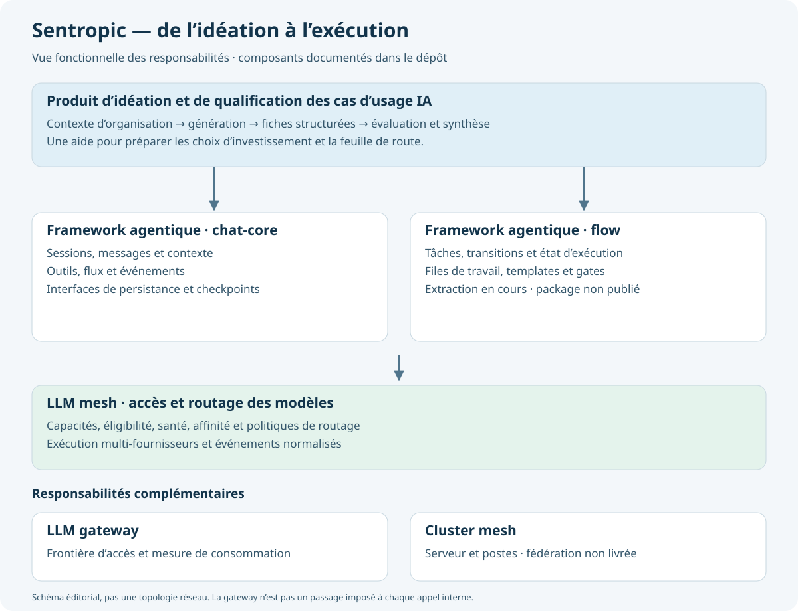

# Dossier de décision — Offres, portfolio et blog SENT-tech

22 septembre 2026 · **Orientation B confirmée par le propriétaire : équilibre conseil d’architecture / réalisation de produits. Préparation des preuves de publication encore partielle.**

## 1. Décision demandée

Choisir la promesse dominante du site, en conservant les trois offres demandées : **A — architecture en tête**, **B — architecture, IA et réalisation à parts visibles**, ou **C — construction de produits en tête**. Le périmètre couvre le positionnement, les offres, la sélection du portfolio et la ligne éditoriale. Ce dossier prépare la refonte ; il ne modifie pas le site publié.

**Décision reçue.** [FACT] Le propriétaire a répondu : « Un équilibre conseil d’architecture et réalisation de produits ». Cette réponse confirme l’orientation B. Elle ne fixe pas une répartition chiffrée du temps ou des revenus et ne vaut pas validation de chaque texte, visuel ou engagement commercial proposé.

## 2. Contexte

**Faits vérifiés**

- [FACT] La demande porte sur architecture d’entreprise, architecture d’entreprise et solutions IA, et « Superbuilder — implémentation de produits innovants », ainsi que dix entrées initiales de portfolio, complétées par CGI — CSP et Sentropic — idéation, et un blog EA / Everyday AI / build IA. Source : demande du propriétaire du 22 septembre 2026.
- [FACT] Le hero actuel annonce « Stratégie Digitale et Innovation ». Les quatre services sont Stratégie IT, Data & IA ; Gouvernance & Architecture ; Développements Innovants ; Optimisation des Opérations. Sources : `src/content/hero/fr/main.md`, `src/content/services/fr/*.md`.
- [FACT] Les références sont affichées dans les détails conditionnels des services ; la page d’accueil ne comporte pas de portfolio autonome. Sources : `src/pages/Index.svelte`, `src/components/ServiceDetails.svelte`.
- [FACT] Le site dispose déjà d’un blog FR/EN en Markdown. Les thèmes existants incluent le développement assisté par IA et l’autonomie des agents. Sources : `src/content/blog/`, `src/lib/content.ts`.
- [FACT] Le cas MatchID affiche 30 M requêtes/an en sous-titre et 10 M/mois dans le texte. Le cas Curateur cite 50 % de gain et un passage de 30 à 85 % sans protocole d’évaluation associé dans la fiche. Sources : `src/content/business-cases/fr/matchid.md`, `curateur.md`. Ce sont des affirmations existantes, pas des résultats revérifiés.
- [FACT] Le cluster mesh décrit un runtime local à serveur unique ; les capacités de fédération entre serveurs restent désactivées. Source : documentation locale `sentropic/packages/cluster-mesh/README.md`.
- [FACT] Aucune arborescence `.track/` n’est présente dans ce checkout. Ce dossier est donc conservé dans `docs/decisions/`, sans initialiser un outil de suivi.

**Lecture du site**

[JUDGMENT] La largeur du parcours est crédible, mais les intitulés actuels obligent le prospect à reconstruire lui-même ce qu’il peut acheter. La priorité est de relier **besoin → offre → preuve → prise de contact**. Changer seulement quatre titres pour trois ne suffirait pas.

[JUDGMENT] Les références doivent devenir visibles avant la longue présentation des secteurs, valeurs et modalités d’engagement. « Temps plein / temps partiel / forfait » reste utile après la présentation du résultat attendu.

[FACT] Cette revue est fondée sur le contenu et les composants du checkout. La tentative d’ouverture du site en navigateur a échoué sur la connexion au navigateur ; ce document ne constitue pas un audit visuel du site en production, ni une analyse de conversion.

**Critère confirmé et hypothèses réversibles**

- [FACT] L’équilibre conseil d’architecture / réalisation de produits est le critère commercial confirmé par le propriétaire dans sa réponse au dossier.
- [FACT] L’investigation du compte Airbus a retrouvé « Everyday AI » comme couche transverse d’accès à l’IA, reliée à des Agent Factories et à un DataHub. [JUDGMENT] Le blog doit traiter cette dimension d’architecture en plus des usages quotidiens ; le périmètre éditorial exact reste à confirmer. Voir [les sources retrouvées](investigation-airbus.md).
- [JUDGMENT] Conserver le bilinguisme FR/EN pour la future refonte. Le dossier et le premier brouillon éditorial sont en français pour faciliter l’arbitrage.

**Inconnues à rendre visibles**

[FACT] Le propriétaire confirme l’équilibre conseil / réalisation, sans préciser de ratio de revenus, les acheteurs prioritaires, la taille des mandats ou la capacité de support après livraison. Les captures Beluga Sunset et Scale Up sont désormais récupérées ; le quadrant CGI — CSP est désormais capturé, tandis que la capture exacte des quadrants Airbus et les détails de SARI restent manquants. Le CV retrouvé étaye le rôle déclaré sur les roadmaps, le coaching IA et la méthode 2×2 ; le statut et les résultats de chaque réalisation restent à qualifier avant publication. Voir [l’investigation Airbus](investigation-airbus.md).

## 3. Enjeux

[JUDGMENT] Il s’agit d’une décision de positionnement public : le choix attire des demandes différentes, engage une promesse de responsabilité et conditionne l’effort éditorial. Le sujet mérite un dossier parce que l’objectif commercial peut inverser le choix et que les références impliquent des organisations tierces.

[JUDGMENT] Le succès se mesure d’abord à la qualité des demandes reçues, pas au nombre de composants techniques exposés. Après publication, suivre les demandes qualifiées par offre, les raisons de contact, le passage portfolio → contact et le décalage entre mandat demandé et mandat souhaité. Aucun objectif chiffré n’est fixé sans point de départ.

[FACT] Seul le dépôt du site reçoit des documents préparatoires. Les dépôts de produits sont consultés en lecture seule ; aucune modification ni publication externe n’a été effectuée.

## 4. Options

Les avantages, risques et estimations du tableau sont des [JUDGMENT], pas des mesures de marché.

| ID | Choix | Meilleur argument pour | Meilleur argument contre | Coût indicatif | Réversibilité | Ce qui le ferait gagner |
| --- | --- | --- | --- | --- | --- | --- |
| A | **Architecture en tête**. « Donner une trajectoire à vos transformations, jusqu’aux solutions IA. » | 1. Rend immédiatement lisibles les roadmaps et le parcours senior. 2. Parle aux directions et responsables architecture. 3. Permet de présenter le build comme preuve de réalisme. | La capacité à construire devient secondaire ; risque de continuer à recevoir surtout des mandats de conseil alors que l’objectif pourrait être de livrer des produits. | Socle commun de refonte + environ 0,5–1 jour de hiérarchisation éditoriale. | Textes et ordre réversibles ; les prospects acquis ne changent pas rétroactivement. | Priorité assumée aux mandats EA, aux trajectoires et aux arbitrages de portefeuille. |
| B | **Trois portes d’entrée, une même capacité à aller jusqu’au concret**. « Architecture d’entreprise, solutions IA et produits innovants. » | 1. Respecte les trois offres demandées. 2. Rend visibles conseil et réalisation. 3. Valorise toutes les familles de preuves sans forcer une spécialisation prématurée. | Message moins tranché ; frontières EA / IA à expliquer ; peut suggérer à tort que chaque mission doit traverser les trois offres ou qu’un même cas prouve tout le parcours. | Socle commun + environ 1–2 jours pour frontières, parcours et liens entre preuves. | Forte sur le site ; coût éditorial si une offre devient secondaire. | Volonté de conserver un portefeuille équilibré de missions, avec des offres achetables séparément. |
| C | **Build en tête**. « Superbuilder — de l’idée au produit utilisable. » | 1. Rend la réalisation centrale. 2. Donne une grande place aux démonstrations Immo, H2a, Sentropic et Engram. 3. Présente l’expérience d’architecture comme un avantage pour construire. | Peut attirer des demandes de développement au périmètre ouvert, sous-estimer l’exploitation et rendre le conseil senior moins visible. « Superbuilder » seul reste ambigu. | Socle commun + environ 2–4 jours de démonstrations, périmètres de livraison et engagements de transfert. | Réversible éditorialement ; changer les engagements commerciaux après vente est plus coûteux. | Priorité commerciale explicite au build et capacité assumée de livraison, transfert et éventuel support. |

## 5. Recommandation et contenu proposé

**Orientation retenue : B.** [FACT] Le propriétaire confirme vouloir attirer un équilibre de missions de conseil d’architecture et de réalisation de produits. [JUDGMENT] Les trois offres doivent donc conserver une visibilité comparable, avec des résultats et des périmètres distincts. L’architecture IA relie les enjeux d’entreprise aux solutions ; Superbuilder reste une offre de réalisation à part entière. Ce choix traduit une préférence commerciale explicite, pas une conclusion tirée de données de conversion.

**Second avis et désaccord conservé.** [FACT] Une revue indépendante Codex recommande une architecture à trois portes d’entrée ; une revue indépendante Opus recommande A enrichie, avec l’IA comme différenciateur et le build comme preuve. Les deux demandent des frontières d’offres explicites, un portfolio autonome et des preuves mieux qualifiées. Le propriétaire a ensuite confirmé l’équilibre conseil / réalisation, ce qui tranche en faveur de B. [JUDGMENT] L’objection d’Opus reste utile pour surveiller la lisibilité du message : une hiérarchie A pourrait mieux convenir si la priorité commerciale changeait vers les directions architecture. Les appréciations de marché formulées par les reviewers n’ont pas été reprises comme des faits établis.

### La promesse

[JUDGMENT — proposition de texte]

> **Architecture d’entreprise, solutions IA et produits innovants.**
>
> J’aide les organisations à choisir leur trajectoire, concevoir leurs solutions IA et construire des produits utilisables — avec une même exigence de clarté, de maîtrise et de transmission.

CTA principal : **Parlons de votre projet**. CTA secondaire : **Voir les réalisations**.

### Trois offres achetables séparément

Tous les textes de cette sous-section sont des [JUDGMENT — propositions commerciales], à adapter aux engagements réellement souhaités.

| Offre | Quand faire appel à toi | Résultat acheté | Livrables possibles | Frontière |
| --- | --- | --- | --- | --- |
| **Architecture d’entreprise — décider et prioriser** | Transformation, portefeuille fragmenté, investissements et dépendances à arbitrer. | Une trajectoire argumentée et des décisions partagées. | Cartographie des capacités et dépendances, scénarios, dossiers de décision, architecture cible, roadmap et gouvernance. | Porte sur l’entreprise ou le portefeuille. Peut inclure l’IA ; ce n’est pas une offre « sans IA ». |
| **Architecture d’entreprise et solutions IA — concevoir et intégrer** | Un besoin IA existe, mais les données, les choix de solution, l’intégration ou les responsabilités restent incertains. | Une capacité IA définie, intégrable et évaluable. | Cadrage des usages, architecture solution, choix de composants et patterns, stratégie d’évaluation, garde-fous, trajectoire d’intégration, coaching des équipes. | Porte sur une capacité ou solution IA. L’implémentation produit est un périmètre distinct, explicite. |
| **Superbuilder — construire des produits innovants** | Une hypothèse produit doit devenir une application ou un service réellement utilisable. | Un incrément fonctionnel sur un périmètre convenu, avec critères d’acceptation et transfert. | Prototype ou MVP ou incrément de production selon contrat ; code, tests, intégrations, déploiement convenu, documentation et transfert. | Ne promet pas indistinctement prototype et production. Support, exploitation et engagements de service sont définis séparément. |

**Architecture d’entreprise.** Clarifier les capacités à développer, les investissements à prioriser et la trajectoire de transformation. Relier les décisions d’affaires aux choix de systèmes, de données et d’organisation.

**Architecture d’entreprise et solutions IA.** Passer d’un cas d’usage à une solution cohérente avec l’entreprise : données, intégrations, modèles, évaluation et supervision humaine. Accompagner les architectes et les équipes jusqu’aux décisions techniques concrètes.

**Superbuilder.** Concevoir et implémenter des produits innovants en associant architecture, développement et méthodes de travail avec les agents IA. Livrer des incréments utilisables, vérifiés et transférables.

[JUDGMENT] Le coaching IA est une modalité importante de l’offre 2. Le harness et les dossiers de décision illustrent une méthode transversale ; ils ne deviennent pas deux offres supplémentaires.

### Parcours du site

[JUDGMENT] Ordre proposé : **promesse → trois offres → réalisations sélectionnées → méthode → articles → parcours → modalités et contact**. Navigation principale : Services · Portfolio · Articles · À propos · Contact.

[JUDGMENT] Montrer quatre cas à l’accueil : Airbus Roadmaps, Airbus Coaching IA, Immo et une réalisation d’intérêt public au rôle bien documenté. Présenter les douze fiches dans le portfolio complet, en regroupant les deux vues de Sentropic dans une même famille. H2a, Sentropic et Engram apportent une profondeur technique avec des diagrammes ; leur vocabulaire ne doit pas être requis pour comprendre les offres.

[JUDGMENT] Chaque fiche comporte : problème, rôle personnel, contribution collective, solution, résultat étayé ou observation qualitative, stade réel, visuel légendé, offre principale et lien public pertinent. Distinguer mission client, contribution de carrière et produit propre lorsque cette qualification est confirmée. Ne pas attribuer automatiquement toutes les réalisations historiques à SENT-tech.

### Les douze fiches du portfolio

Les angles et affectations sont des [JUDGMENT]. La colonne « preuve » distingue les [FACT] disponibles des éléments manquants. Les textes ci-dessous sont des pistes de rédaction, pas des attestations de rôle personnel.

| Cas | Angle et offre principale | Visuel / preuve | À compléter pour la fiche finale |
| --- | --- | --- | --- |
| **Immo — intelligence territoriale et analyse immobilière** | Transformer des sources documentaires et géographiques en exploration exploitable. Superbuilder. | [FACT] Capture récupérée dans le dépôt demandé, version expurgée jointe : [capture](assets/immo-expurge.png). | Rôle, stade et résultat ; niveau d’anonymisation attendu. La géométrie de carte reste reconnaissable : pas de garantie d’anonymat territorial. |
| **Airbus — Roadmaps d’architecture d’entreprise** | Relier trajectoire du SI, dépendances et maturation du portefeuille. EA. | [FACT] Captures Beluga Sunset et Scale Up récupérées dans le Drive ; sources et légendes dans [l’investigation](investigation-airbus.md), images en [galerie locale](../../../.artifacts/airbus-portfolio-review/index.html). | Préparer une version publiable des extraits internes ; distinguer scénarios et résultats. Rôle déclaré étayé par le CV retrouvé. |
| **Airbus — Coaching IA, de l’architecture d’entreprise au tech lead** | Relier méthode de quadrants, choix d’architecture et pratique des équipes. EA / solutions IA. | [FACT] CV : coaching, cadrage produit, delivery et méthode sectorielle 2×2. Tableau Digital : valeur / complexité pour PoC et cible. Framework Airbus consulté. | Capture exacte des quadrants encore recherchée ; objectif, contribution et statut des cas d’usage à préciser. Ne pas développer l’acronyme SARI sans source. |
| **CGI — CSP : prioriser les cas d’usage IA** | Passer de l’exploration des usages à une présélection argumentée et une feuille de route. EA / solutions IA. | [FACT] Présentation du 15 juillet 2024, cosignée Fabien Antoine ; quadrant diapo 8 récupéré, inspecté et redessiné dans le style Sentropic fourni. [Sources et capture locale](investigation-cgi-sentropic.md). | Décrire le rôle et le travail collectif ; adapter le visuel confidentiel pour publication. Les estimations sont des potentiels, pas des gains réalisés. |
| **H2a — organiser le travail humain–agent** | Rôles, coordination, vérification et décisions compréhensibles. Superbuilder / méthode. | [FACT] Documentation H2a, Harness et Focus consultée. [Diagramme](assets/h2a.svg) de leurs rôles complémentaires. | Scénario d’usage réel et rôle personnel. Le schéma ne revendique pas une orchestration automatique de toutes ces briques. |
| **Sentropic — idéation et qualification de cas d’usage IA** | Outiller l’exploration, la génération et l’évaluation d’un portefeuille de cas d’usage. Superbuilder / solutions IA. | [FACT] Application [sentropic.sent-tech.ca](https://sentropic.sent-tech.ca), README et workflow de génération consultés. Capture de matrice fournie par le propriétaire : [visuel](assets/sentropic-matrice-fournie.png). Le site répond et présente une connexion par passkey. [Vue produit et composants](assets/sentropic-product-framework.svg). | Capture de matrice disponible ; parcours complet à vérifier dans une session authentifiée, rôle, stade et résultats d’usage à préciser. Ne pas présenter le code comme preuve d’un parcours testé en production. |
| **Sentropic — LLM mesh et framework agentique** | Construire des applications IA sur des composants aux responsabilités explicites : orchestration, accès aux modèles et exécution. Solutions IA / Superbuilder. | [FACT] LLM mesh : éligibilité, routage et streaming multi-fournisseurs ; chat-core / flow : sessions, outils, état, tâches et transitions. [Fondations](assets/sentropic.svg) et [framework](assets/sentropic-product-framework.svg). | Démonstration par composant et stade d’usage. Extraction de flow encore décrite WIP et non publiée ; fédération du cluster mesh non livrée. |
| **Engram — mémoire graphe** | Relier les connaissances, leurs sources et leurs relations pour retrouver un contexte exploitable. Superbuilder. | [FACT] Documentation locale d’extraction et de consultation de graphes consultée. | Démonstration courte : sources → entités / relations → interrogation avec provenance. Vérifier persistance, actualisation et limites avant d’en faire des promesses. Utiliser uniquement le nom Engram. |
| **Curateur Public — analytics et aide à la détection** | Évaluer un usage analytique avec les contraintes des données et du contrôle humain. Solutions IA. | [FACT] Fiche actuelle décrivant une étude et un PoC. | Rôle, protocole, limites et statut. Retirer les gains chiffrés du nouveau texte tant que définition et source ne sont pas réconciliées. |
| **MatchID — appariement de données** | Rendre des rapprochements de données imparfaites utilisables dans un service. Superbuilder. | [FACT] Fiche actuelle et liens vers matchid.io, deces.matchid.io et l’organisation GitHub. | Rôle et chronologie ; remplacer les métriques contradictoires par une formulation qualitative, ou fournir une métrique datée et sourcée. |
| **Judilibre — anonymisation et diffusion des décisions** | Chaîne NLP, validation humaine et mise à disposition des décisions. Solutions IA / build. | [FACT] Fiche `nlp-justice.md` décrivant détection d’entités, validation, MLOps et API ; lien Cour de cassation. | Distinguer contribution personnelle, réalisation de l’équipe et périmètre du programme Judilibre. |
| **HistoVec — service public numérique** | Transformer des données administratives en service rendu aux usagers. Superbuilder. | [FACT] Fiche existante et liens vers le service et GitHub. | Rôle exact, période, périmètre livré. Ne pas réutiliser le volume de consultations sans date et source. |

### Du quadrant à la réalisation : rendre les preuves lisibles

[JUDGMENT] Les ajouts renforcent l’équilibre demandé : **CGI — CSP** montre la méthode d’arbitrage ; **Sentropic — idéation** montre un produit qui outille la génération et la qualification des usages ; **LLM mesh et framework agentique** montrent les fondations techniques de réalisation. Ce rapprochement est éditorial : aucune intégration ou filiation technique entre le mandat CGI et le produit n’est affirmée.

- **CGI — CSP.** « Structurer l’exploration des usages IA, expliciter les critères de valeur et de faisabilité, puis préparer une feuille de route avec les parties prenantes. » Le cadran observé porte la valeur en vertical et la facilité d’implémentation en horizontal : une valeur forte et une facilité forte apparaissent en haut à droite.
- **Sentropic — idéation.** « Transformer un contexte d’organisation en cas d’usage structurés, les explorer et les évaluer pour préparer les choix d’investissement. » Le parcours de génération documente préparation du contexte, matrice, liste, fiches détaillées et synthèse.
- **LLM mesh.** « Découpler les applications du choix des fournisseurs et des modèles, avec des règles explicites d’éligibilité et de routage. » Authentification des appelants et mesure de consommation restent des responsabilités distinctes de gateway.
- **Framework agentique.** « Organiser les interactions, les outils et les workflows d’un produit IA, avec un état et des transitions explicites. » Les ports et composants sont présents dans le dépôt ; leur extraction en packages ne doit pas être présentée comme un framework publié et stabilisé.

[JUDGMENT] H2a / Harness / Focus décrivent la méthode de travail pour construire avec les agents. Le framework Sentropic décrit l’orchestration dans le produit. Les deux méritent des exemples séparés.

### Visuels : ce qui est prêt et ce qui manque

[FACT] La capture Immo jointe a été récupérée depuis `../radar-immobilier/docs/reports/assets/2026-09/signaux-zonage-couleurs.png`. Marque, avatar et libellés géographiques latéraux sont masqués ; le fond de carte est flouté. La capture ne prouve ni les performances ni un stade de production. Les détails de transformation sont dans [les notes de préparation](preparation.md).

[FACT] Trois diagrammes originaux sont joints : H2a, les fondations Sentropic et la vue produit / framework Sentropic. [JUDGMENT] Leur niveau est volontairement fonctionnel, avec une limite de maturité visible sur les vues Sentropic. Ils servent de base éditoriale et ne sont pas des diagrammes de déploiement exhaustifs.

[FACT] Deux visuels principaux Airbus sont récupérés : Beluga Sunset (diapo 10 de la roadmap) et Scale Up (image native extraite du bilan FA). Un troisième montre le contexte du portefeuille Scale Up. Les sources et images inspectées figurent dans [l’investigation](investigation-airbus.md) et la [galerie locale](../../../.artifacts/airbus-portfolio-review/index.html). La capture exacte des quadrants Airbus reste à trouver. Le quadrant CGI — CSP est, lui, récupéré dans la présentation du 15 juillet 2024 ; voir [la source et la capture](investigation-cgi-sentropic.md). [JUDGMENT] Les originaux internes servent à la revue ; préparer des extraits adaptés avant publication. Aucun substitut inventé n’est présenté comme capture du projet.

[FACT] Le cadran CGI — CSP est également redessiné : 30 cas, six domaines et dix présélectionnés, étiquettes sans chevauchement, axe de facilité conservé. Les positions sont approximatives, sans scores inventés ; les flèches de trajectoire originales ne sont pas reprises. [Comparer la source et la version redessinée](../../../.artifacts/cgi-portfolio-review/index.html).

### Ligne éditoriale et premier article

[JUDGMENT] Une promesse éditoriale commune : **« Quels choix d’architecture rendent l’IA utile, intégrable et exploitable ? »** Deux séries suffisent :

| Série | Lecteur / question | Sujets initiaux | Lien avec les offres |
| --- | --- | --- | --- |
| **Architecture d’entreprise et Everyday AI** | Directions, architectes et responsables IA : quels composants mutualiser et quelles responsabilités conserver ? | Idéation et présélection valeur / facilité ; assistant métier et sources ; LLM mesh / gateway ; identité et permissions ; document-to-diagram ; mémoire graphe et provenance. | EA et solutions IA. |
| **Construire avec l’IA** | Responsables produit et tech leads : comment livrer un système vérifiable ? | Framework agentique : sessions, état, outils et workflows ; effets de bord ; harness et décision humaine ; deep analytics ; passage du prototype à l’exploitation. | Superbuilder et coaching IA. |

[JUDGMENT] Cadence de départ : un article substantiel par mois, alternant les séries, avec une note courte uniquement lorsqu’une preuve intéressante existe. Cette cadence est une proposition à adapter au temps disponible.

[JUDGMENT] Premier article proposé : **« De l’Everyday AI aux produits agentiques : quels composants d’architecture pour quels usages ? »** Le [brouillon complet](article-everyday-ai.md) compare assistant, workflow, agent et deep analytics, puis relie les patterns aux activités de delivery. Il formule une grille de lecture d’architecte ; il ne prétend pas établir des tendances de marché chiffrées ou un état exhaustif de septembre 2026.

[FACT] Les brouillons du blog actuel peuvent être affichés avec un badge et leur route reste chargeable (`src/components/Blog.svelte`, `src/lib/content.ts`). Le nouvel article est donc préparé sous `docs/`, hors du contenu embarqué, jusqu’à finalisation éditoriale.

### Contre-argument, conditions de renversement et pré-mortem

**Meilleur argument contre B.** [JUDGMENT] Un acheteur ne cherche pas nécessairement un continuum. Trois compétences en tête peuvent diluer la spécialité et laisser croire à une structure plus large que la capacité disponible. A serait plus net pour un mandat EA ; C serait plus net pour un produit à livrer.

**Ce qui renverserait la recommandation.** [JUDGMENT] Une préférence claire pour les grands mandats EA fait gagner A. Une volonté de consacrer l’essentiel du temps au build, avec un périmètre d’exploitation assumé, fait gagner C. Des retours de prospects montrant que trois offres brouillent la compréhension imposeraient de hiérarchiser B.

**Pré-mortem.** [JUDGMENT] Six mois plus tard, le repositionnement a échoué parce que le site a accumulé des noms de produits et des diagrammes sans clarifier les problèmes clients. Les prospects demandent des prototypes à bas coût, tandis que les missions EA recherchées se raréfient. Les références n’expliquent pas assez le rôle personnel ; le blog consomme du temps sans produire de demandes pertinentes. Pour détecter cela tôt : qualifier les demandes par offre et relire les objections après les premiers échanges commerciaux.

**Intérêt de l’agent présentateur.** [JUDGMENT] B est plus facile pour moi : il réutilise presque tous les matériaux et évite de choisir une spécialisation. Cet avantage de production documentaire ne prouve aucun avantage commercial.

**Intérêt du propriétaire.** [JUDGMENT] Attirer le bon travail, préserver la valeur du parcours, assumer seulement les engagements souhaités, protéger les références et limiter l’effort éditorial récurrent.

## 6. Réversibilité et coût

[JUDGMENT] Estimation de travail, sans devis ni connaissance du budget : **4–7 jours de socle commun pour le périmètre initial**, incluant rédaction des trois offres, portfolio autonome, préparation des douze fiches, intégration FR/EN, vérification mobile et SEO. Ajouter le différentiel de positionnement du tableau §4. Avec CGI — CSP et la fiche produit Sentropic ajoutés, réévaluer cette enveloppe après préparation des visuels ; elle ne constitue pas une estimation ferme des douze fiches. Cette estimation exclut les délais pour obtenir les captures et preuves, une nouvelle identité visuelle et un développement produit.

[JUDGMENT] Séquence proposée :

1. Fixer la promesse dominante et les frontières d’offres.
2. Finaliser rôle / stade / résultats des douze fiches, préparer les extraits Airbus récupérés et retrouver la capture exacte des quadrants.
3. Intégrer services, portfolio et liens de contact ; préserver les anciennes ancres via correspondances.
4. Finaliser le premier article, sa version anglaise et les visuels adaptés au web.
5. Vérifier les parcours, les textes FR/EN, les images, les anciennes URL, les métadonnées et le sitemap avant mise en ligne.

[FACT] Les services sont liés au routage par identifiants et catégories, pas uniquement par textes Markdown (`src/pages/Index.svelte`, `src/components/Services.svelte`, `src/lib/content.ts`). Une intégration correcte doit ajuster ces correspondances, la grille à quatre colonnes et les textes i18n.

[JUDGMENT] Retour arrière : revenir à la version précédente des contenus, composants, assets et métadonnées, puis redéployer. Conserver les URL du blog existant. Le coût irrécupérable principal est rédaction / préparation visuelle ; les attentes créées auprès des prospects ne sont pas annulées par un rollback.

## 7. Attendus

| Critère | Source | Couvert par | Écart explicite |
| --- | --- | --- | --- |
| Trois offres EA / EA et solutions IA / Superbuilder | Demande du propriétaire et réponse au dossier | §5, résultats et frontières | Équilibre conseil / réalisation confirmé ; aucun ratio chiffré imposé. |
| Revue du site existant | Demande du propriétaire | §2, §5, §6, contenu et composants vérifiés | Audit visuel live non réalisé ; distinct de l’arbitrage éditorial. |
| Douze fiches de portfolio (dix initiales + deux ajouts) | Demande du propriétaire | Matrice §5 | Rôles et stades à compléter avant publication. |
| Immo avec capture et tentative d’anonymisation | Demande du propriétaire | Image expurgée et limites explicites | Anonymat territorial non garanti. |
| Airbus Roadmaps, Beluga Sunset / Scale Up | Demande du propriétaire | Captures et sources récupérées, galerie locale | Adaptation des extraits internes pour publication. |
| Airbus coaching, quadrants, agentique, document-to-diagram, SARI | Demande du propriétaire | CV, tableau d’évaluation et framework retrouvés | Capture exacte des quadrants et description SARI manquantes. |
| CGI — CSP, quadrant | Ajout du propriétaire, CGI confirmé | Présentation source et capture diapo 8 inspectée | Préparer un extrait publiable. |
| Sentropic idéation, LLM mesh et framework agentique | Ajout du propriétaire | Deux fiches complémentaires, composants documentés et diagramme | Capture de matrice fournie ; parcours live non testé et maturité précisée. |
| Diagrammes H2a et Sentropic | Demande du propriétaire | Trois SVG avec limites | Validation du niveau de présentation au moment de finaliser les fiches. |
| Engram, mémoire graphe, sans ancienne appellation | Demande du propriétaire | Fiche Engram et article | Démonstration et rôle à confirmer. |
| Blog EA, patterns, Everyday AI, build agentique et deep analytics | Demande du propriétaire | Ligne éditoriale et article rédigé | Sens d’Everyday AI à confirmer ; traduction EN à réaliser après choix éditorial. |
| Comparaison honnête et réversible | Skill present-decision | §4–6 ; contre-argument et pré-mortem | Aucun score de marché inventé. |
| Avis indépendants Codex et Opus | Skill present-decision | §5 et notes de préparation | Désaccord A/B conservé ; aucun consensus fictif. |

## 8. Décision reçue et informations restantes

**[FACT] Orientation B confirmée : « Un équilibre conseil d’architecture et réalisation de produits ».** Source : réponse explicite du propriétaire à la question sur les missions à attirer.

[JUDGMENT] Conséquences éditoriales : trois offres visibles et achetables séparément, preuves de conseil et de réalisation présentes dès l’accueil, et deux séries de blog complémentaires. La réalisation de produits ne doit pas apparaître comme une simple illustration du conseil. L’équilibre demandé ne suppose ni un partage 50/50 du chiffre d’affaires ni un tiers de l’espace pour chaque offre.

L’investigation demandée a retrouvé les sources Beluga Sunset et Scale Up et documenté un sens architectural d’Everyday AI. Le quadrant CGI — CSP est également retrouvé et capturé ; Sentropic idéation, LLM mesh et framework agentique sont explicités dans [l’investigation complémentaire](investigation-cgi-sentropic.md). Restent la capture exacte des quadrants Airbus, la description de SARI et la finalisation des fiches publiques. Voir [les résultats et les limites de la recherche](investigation-airbus.md).
