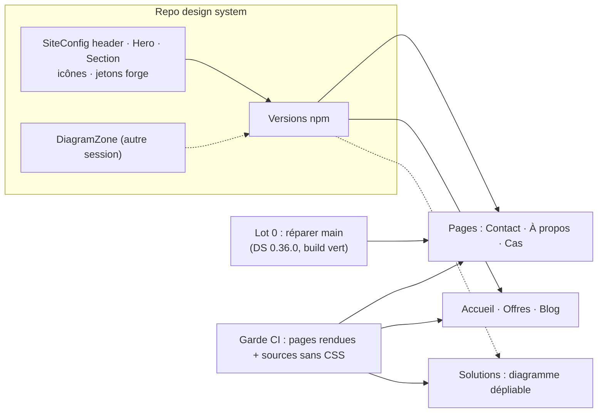

# Décision refonte site SENT-tech — 100 % design system, offres et cas

> Budget de lecture : 18 minutes, 9 questions en 3 lots (4 + 4 + 1). Chaque question tient en 2 minutes.
> Statut : **décidé** le 2026-11-06 (révision 2, après relectures Codex et Opus, voir `reviews.md`). Rédigé le 2026-11-05.

## Décisions reçues (2026-11-06, réponses du propriétaire dans la conversation « sentech »)

| Question | Réponse |
|---|---|
| Q1 Code custom | Assemblage de composants DS permis ; aucun CSS, classe, style inline ni SVG dans le site |
| Q2 Ordre | Lot 0, puis mise en ligne page par page |
| Q3 Diagramme | Image d'ensemble et texte dépliable par zone (100 % DS) en attendant `DiagramZone` |
| Q4 Accueil | Hero · Offres · Cas · Solutions · À propos · Blog · Contact ; cartes du hero : PoC, MVP, Architecture, Cas, Solutions |
| Q5 Prix | Dollars canadiens ; jamais « + taxes » : les taxes s'ajoutent à la facture. EN : « $3,000 CAD » |
| Q6 Tokens | En dollars canadiens, pas en $US : environ 20 milliards de tokens pour l'équivalent de 200 $ au tarif refacturé de Radar immo (voir `chiffres.md`, O2) |
| Q7 Chiffres | Tableau `chiffres.md` validé en bloc : tout publier, y compris les chiffres déclarés et ceux sans source |
| Q8 Clients | Option 1 (client nommé, méthode générique). Quadrant CSP laissé comme avant. **Règle : ne pas retoucher l'existant ; toute modification d'une fiche existante est validée fiche par fiche sur présentation avant/après** |
| Q9 Classement | 5 catégories, plus une étiquette d'offre ; la nouvelle catégorie de chaque fiche existante est présentée avant écriture |
| Curateur | Version du CV (50 % → 95 %), présentée en avant/après avant écriture |

Conséquences de la règle Q8 :
- la fusion « AI Architecture Framework » prévue dans l'annexe A est abandonnée ; le nouveau cas « architecture IA » est une fiche distincte ;
- les fiches SODES et Scale-Up existantes ne sont pas réécrites.
> L'orientation de `../2026-09-services/dossier.md` reste valable : « Un équilibre conseil d'architecture et réalisation de produits ».

## Demande du propriétaire (2026-11-05, conversation Claude Code « sentech »)

> « Bon on va faire un redesign complet du site web
> 1. le sylte reste le meme - au moins le header et le hero
> 2. mais 100% des composants doivent être design system - donc on bascule a 100% tu me fais arbitrer faut pas un bout de code custom
> 3. on garde le blog mais on change les services, les business cases, on ajoute la solution sentropic
> 4. les services […] 5. business cases […] 6. Solution d'accélération : H2a, Engram, Sentropic, Design system - présenter les valeurs et cas d'usage (lier aux business cases ci-dessus), mets le diagramme dépliable validé »

## Ce qui change pour toi

Le site présentera trois offres achetables (PoC, MVP, architecture), environ 35 cas classés et tes quatre solutions. Il le fera sans aucune ligne de style propre au site. Les risques que tu portes :
- **délai** : certaines briques manquent au design system (DS) et doivent y être livrées avant les pages qui en dépendent ;
- **affirmations publiques** : chiffres non sourcés et matériel client confidentiel.

## Constat

- **[FACT] La production n'est pas `main`.** Le build CI échoue chaque semaine depuis le commit `4e9d98c` du 17/06 (« migrate site shell to NavSystem »). Ce commit importe `NavDrawer`, absent du paquet DS 0.34.49 verrouillé dans `package-lock.json`. Dernier build vert : `fa52267`, le 15/06. Le site en ligne date donc de juin.
- **[FACT] Code propre au site.** 14 composants Svelte, `App.svelte` et les pages mêlent des composants DS à des classes Tailwind, des surcharges `!important`, des styles inline `--st-component-*`, un SVG dessiné à la main et des effets de flou. S'y ajoutent un pont de jetons shadcn, des dégradés maison, un rendu Markdown qui émet des classes, et 46 noms d'icônes `lucide-svelte`.
- **[FACT] Ce que le DS 0.36.0 couvre déjà.** Le header partagé est porté par `AppShell variant="site"` et son contrat `SiteConfig` (marque, navigation, langue, thème), que le site n'utilise pas. Le DS fournit aussi `Card`, `Tile`, `Badge`, `Typography`, `Grid`, `Stack`, `Container`, `KpiCard`, `Collapsible`, `Footer`, `Form`, `ScatterPlot`, `DataImage`, `Embed` et 8 icônes.
- **[FACT] Manques réels du DS** (taille estimée) :

| Manque | Ce qu'il faut ajouter au DS |
|---|---|
| Header transparent au-dessus du hero, burger mobile à droite | 2 clés additives dans `SiteConfig` (le contrat `docs/header-alignment-contract.md` les décrit déjà) |
| Hero : image plein écran, voile dégradé, indicateur de défilement, taille pleine ou compacte | Composant `Hero` |
| Fonds de section alternés (neutre, léger, inversé, dégradé) | Composant `Section`, ou prop de fond sur `Container` |
| 46 icônes | Une entrée par icône dans le registre `Icon` |
| Dégradés et pastilles dégradées | Jetons du thème `forge` |
| Diagramme dépliable | `DiagramCard` / `DiagramZone`, en spec seulement, sur une branche locale d'une autre session DS |

- **[FACT] Le DS peut publier un composant Svelte seul.** Les écarts de parité sont inscrits dans `packages/component-index/parity-baseline.json`, dans le même commit.

## Diagramme

## Décidé sans te solliciter (réversible ; dis-moi si tu n'es pas d'accord)

- **Lot 0** : passer le site en DS 0.36.0 et rétablir le build, avant toute refonte.
- **Ordre DS** : Svelte d'abord ; les ports React, Vue et Angular sont des écarts inscrits et suivis dans le track du DS. Un lot du track du DS fixe l'ordre de fusion avec la session « diagram-cards », qui touche aux mêmes fichiers.
- **Header** : `AppShell variant="site"` complété par les 2 clés `SiteConfig`. Le `Navigation.svelte` actuel disparaît.
- **Hero** : image, voile, titre blanc, cartes à 95 % opaques avec léger flou, effet de survol, pastilles dégradées et indicateur de défilement sont conservés, tous fournis par le DS. `PRODUCT.md` ne refuse que le verre « non justifié ».
- **Icônes** : Lucide via le registre `Icon` du DS. La famille bleue duotone de la spec diagrammes reste réservée aux diagrammes.
- **Garde-fou CI** :
  - audit DS sur les pages rendues dans un navigateur (Playwright est déjà présent), car l'audit statique ne voit pas une SPA ;
  - contrôle des sources : aucun `class`, `style`, `<svg>`, Tailwind ni CSS dans `src/`. Tailwind est retiré du site.
  - Prérequis : publier `@sentropic/design-system-skills` 0.3.2 (npm est en 0.1.0).
- **SEO** : une page unique avec ancres, comme aujourd'hui. Les URLs, shells, sitemap et hreflang actuels sont conservés. Une page par cas reste une suite possible.
- **FR/EN** : je rédige l'anglais, tu valides dans la PR. Les 23 cas FR et 24 cas EN sont réalignés (`genai-chatbot` à traduire).
- **BPMN** : modèle public OMG MIWG `C.4.0.bpmn` (CC BY 3.0, attribution affichée) rendu par l'élément DS `st-bpmn-canvas`.

---

## Lot 1 — méthode et périmètre

### Q1 — Ce qui compte comme « code custom »

**Contexte.** Tu demandes zéro code custom. Deux lectures sont possibles, et elles changent le volume de travail dans le DS. Exemple : une carte d'offre peut être un assemblage `Card` + `Typography` + `Badge` + `UnorderedList` + `Button` écrit dans le site, ou un nouveau composant « carte d'offre » du DS.

| Option | Choix | Conséquence pour toi | Coût / retour arrière |
|---|---|---|---|
| A | Le site peut **assembler** des composants DS, mais sans aucun CSS, `class`, style inline ni dessin propre ; contrôlé en CI | Environ 5 ajouts au DS (tableau ci-dessus), site livré plus tôt | Faible |
| B | Tout motif répété devient un composant DS (carte d'offre, carte de cas, rendu d'article…) | 10 ajouts ou plus au DS, réutilisables ailleurs, site plus tard | Moyen |

**Recommandation [JUDGMENT] : A.** Le contrôle CI rend la règle vérifiable, et un motif pourra remonter au DS quand un deuxième site en aura besoin.
**Ce qui renverserait :** si tu veux que ces motifs servent à d'autres sites dès maintenant.

### Q2 — Ordre de mise en ligne

**Contexte.** La production date de juin, et les nouvelles offres ne sont pas en ligne. Contact, À propos et Cas peuvent être faits avec le DS actuel. L'accueil et le blog attendent le hero, la section, les icônes et les jetons. Solutions attend le diagramme.

| Option | Choix | Conséquence pour toi | Coût / retour arrière |
|---|---|---|---|
| A | Lot 0, puis mise en ligne **page par page** dès que leurs briques DS sont publiées | Offres visibles tôt ; pendant la transition, des pages anciennes et nouvelles cohabitent | Faible |
| B | Lot 0, puis nouveau contenu publié **tout de suite** dans l'ancien habillage, puis migration DS | Offres en ligne en quelques jours ; code custom temporaire, contraire à ta demande | Faible, puis migration |
| C | Lot 0, puis bascule **d'un seul coup** quand tout le DS est prêt | Lancement net ; nouvelles offres retardées jusqu'au dernier composant | Nul |

**Recommandation [JUDGMENT] : A.** Les offres sortent tôt sans code custom.
**Ce qui renverserait :** si un prospect doit voir les nouvelles offres cette semaine (B).

### Q3 — Diagramme dépliable validé

**Contexte [FACT].** Le diagramme de gouvernance que tu as validé le 21/10 (« incluant le mécanisme de dépliement interactif ») existe en fichier HTML autonome de 1,8 Mo. Ce fichier contient aussi le journal de tes retours (citations, chemins de captures), 16 mentions d'un projet Airbus interne et des boutons de réponse. Les composants DS réutilisables qui le remplaceront ne sont qu'en spec, et la spec indique que ce fichier n'est plus la référence de l'état replié.

| Option | Choix | Conséquence pour toi | Coût / retour arrière |
|---|---|---|---|
| A | **Exception temporaire** : extraire le diagramme seul (sans journal, sans mentions internes, sans boutons) et l'afficher dans un cadre intégré, signalé comme code custom | Dépliement interactif dès la mise en ligne ; du code hors DS jusqu'à la sortie de `DiagramZone` | Moyen (extraction dans le repo sentropic) |
| B | Vue d'ensemble en image (`DataImage`), et texte de chaque zone dépliable sous l'image (`Collapsible`) | 100 % DS ; on déplie le texte, pas le diagramme | Faible |
| C | Pas de diagramme avant `DiagramZone` | 100 % DS ; section Solutions sans visuel, sans date | Nul |

**Recommandation [JUDGMENT] : B.** Elle respecte ta règle sans publier de matériel interne ; le vrai dépliement arrivera avec `DiagramZone`.
**Ce qui renverserait :** si le dépliement dans le diagramme lui-même compte plus que la règle « zéro custom » (A).

### Q4 — Sections de l'accueil

**Contexte.** Accueil actuel : Hero · Services · Secteurs · Valeurs · Modèles d'engagement · À propos · Blog · Contact. Les 5 cartes du hero pointent vers Services, Secteurs, Valeurs, Engagement et Blog. La 3ᵉ offre (architecture, temps partiel ou plein temps) recouvre les modèles d'engagement, et les cas classés recouvrent les secteurs.

| Option | Choix | Conséquence pour toi | Coût / retour arrière |
|---|---|---|---|
| A | Hero · Offres · Cas · Solutions · À propos · Blog · Contact ; Secteurs, Valeurs et Engagement retirés. Les 5 cartes du hero deviennent : PoC, MVP, Architecture, Cas, Solutions | Page centrée sur l'achat | Faible : contenu gardé dans git |
| B | Comme A, et Valeurs conservées en version courte entre Solutions et À propos | Garde ton positionnement (pragmatisme, ROI…) ; page plus longue | Faible |
| C | Tout garder et ajouter Offres, Cas et Solutions | Rien de perdu ; page longue, messages dilués | Faible |

**Recommandation [JUDGMENT] : A.** Les valeurs se lisent déjà dans les cas et dans À propos.

---

## Lot 2 — commercial et preuves

### Q5 — Devise et taxes des prix

**Contexte.** Tu as fixé : PoC 3 000 $, MVP 10 à 20 k$, architecture sans prix. Rien n'indique la devise ni les taxes. Le site anglais sera lu comme étant en dollars US.

| Option | Choix | Conséquence pour toi |
|---|---|---|
| A | « 3 000 $ CA, plus taxes » sur les deux langues | Clair pour un client québécois ou étranger |
| B | Dollars canadiens en français, équivalent en dollars US en anglais | Plus parlant à l'étranger ; deux grilles à tenir |
| C | Pas de devise ni de taxes | Ambigu, contestable sur facture |

**Recommandation [JUDGMENT] : A.**

### Q6 — Formulation des tokens inclus dans le PoC

**Contexte [FACT].** Tu demandes de préciser le nombre de tokens pour l'équivalent de 200 $ d'un compte. Mesure corrigée de Radar immo : 12,37 milliards de tokens du 12/08 au 10/09/2026, pour 118 $ CA de quote-part d'abonnements. La capacité observée d'un abonnement Claude Max à 200 $US est d'environ 32 milliards de tokens par mois, au pic. Ces volumes sont surtout de la relecture de cache ; la part hors cache n'est pas mesurée (`unknown`). Le fournisseur peut changer les plafonds.

| Option | Choix | Conséquence pour toi |
|---|---|---|
| A | « Outillage agentique inclus, jusqu'à 200 $US/mois », avec une note : « à titre indicatif, environ 30 milliards de tokens par mois observés sur un abonnement de ce niveau, cache compris » | Le chiffre demandé, avec ses limites ; ton engagement porte sur les dollars, pas sur les tokens |
| B | « Outillage agentique inclus, jusqu'à 200 $US/mois », sans nombre de tokens | Aucun chiffre contestable ; s'écarte de ta demande |
| C | Le nombre de tokens hors cache, après calcul | Plus juste, plus petit ; calcul à faire |

**Recommandation [JUDGMENT] : A.**

### Q7 — Chiffres sans source vérifiée

**Contexte [FACT].** Sans source ou contradictoires :
- **2 M pi² concrétisés** : `missing source`.
- **Moins de 10 k$** pour Radar : seuls les coûts LLM et infrastructure sont mesurés, pas les honoraires.
- **500 kSLOC** : environ 395 k lignes de code comptées, méthode à documenter.
- **1 h 30 → 15 min par CV** : non mesuré.
- **Mises à jour de sécurité « 0 day »** : boucle automatique désactivée.
- **Saisie Revenu Québec et collecte par courriel** : aucune exécution tracée.
- **Curateur public** : ton CV de février 2025 dit 50 % → 95 % de couverture ; le site dit +50 % d'efficacité et 30 % → 85 %.
- **MatchID** : 30 M de requêtes par an contre 10 M par mois.
- **1 106 villes** : c'est le périmètre visé ; en juillet, 994 avaient leurs procès-verbaux.
- **Précision/rappel** : protocole d'évaluation à citer.

| Option | Choix | Conséquence pour toi |
|---|---|---|
| A | Publier seulement le mesuré, daté ; décrire le reste sans chiffre (Curateur et MatchID inclus) | Rien de contestable ; cas moins frappants |
| B | Publier tes chiffres tels que tu les déclares | Plus percutant ; tu portes la preuve |
| C | Tu fournis les sources maintenant, chiffre par chiffre (texte libre) | Le meilleur des deux, si les sources existent |

**Recommandation [JUDGMENT] : A, complétée par C pour ce que tu peux sourcer.**

### Q8 — Ce qu'on dit des mandats clients

**Contexte [FACT].** Le site nomme déjà Airbus, Bombardier, Rio Tinto, le Curateur public et des ministères. Plusieurs nouveaux cas reposent sur des documents internes Airbus marqués « Amber » : HR Policy Navigator, Knowledge Catalog avec Google, maturité des processus Scale-Up, priorisation des cas d'usage. Le quadrant CSP vient d'une diapositive CGI marquée « Confidentiel » ; un dessin refait n'est pas une anonymisation.

| Option | Choix | Conséquence pour toi | Coût / retour arrière |
|---|---|---|---|
| A | Client nommé, méthode décrite de façon générique ; ni nom de programme interne, ni fournisseur partenaire, ni visuel issu de documents clients | Risque contenu ; cas moins concrets | Faible |
| B | Comme A, avec les noms de programmes (HR Policy Navigator, Knowledge Catalog) | Plus crédible ; expose des projets internes | Moyen |
| C | Clients anonymisés (« grand avionneur ») | Prudent ; moins de crédibilité, alors que le site les nomme déjà | Faible |

**Recommandation [JUDGMENT] : A.**

---

## Lot 3 — classement

### Q9 — Classement des cas

**Contexte.** Aujourd'hui, 12 cas sur 23 portent plusieurs catégories (Stratégie, Architecture, Innovation, Opérations). Tu demandes de les reclasser et de relier les solutions aux cas.

| Option | Choix | Conséquence pour toi |
|---|---|---|
| A | 5 catégories par type de valeur (une par cas), plus une étiquette d'offre (PoC, MVP, Architecture) sur chaque cas | Lecture « ce que je peux acheter pour ça » ; catégories inégales (11 / 4 / 10 / 7 / 2) |
| B | Plusieurs étiquettes par cas, comme aujourd'hui, avec un filtre | Souple ; pas de parcours guidé |
| C | 3 groupes, un par offre | Très commercial ; mal adapté aux mandats anciens |

**Recommandation [JUDGMENT] : A.**

---

## Annexe A — contenu proposé

**Offres**
1. **Discovery / PoC** — 1 mois, 3 000 $ ; tokens selon Q5 et Q6. Cas typiques : consolider une application « vibe codée » ; détection, classification ou extraction d'entités ou d'événements sur un corpus ; faisabilité d'un problème métier à valeur claire. Méthode : entretien d'1 h pour évaluer l'opportunité commune et cibler le besoin → proposition en 1 à 2 semaines → réalisation en 1 mois.
2. **Développement / MVP** — 10 à 20 k$ : accompagnement jusqu'à la mise en production d'un premier cas.
3. **Architecture d'entreprise, données et IA** — temps partiel ou plein temps : feuilles de route, priorisation de projets, cadrage et architecture de solution.

**Cas** (★ = nouveau ou refondu ; libellés soumis à Q7 et Q8)
- **Stratégie et architecture d'entreprise** :
  - ★ priorisation des cas d'usage IA (Airbus)
  - ★ architecture IA, feuille de route agentique et catalogue de connaissances (Airbus ; fusion avec « AI Architecture Framework »)
  - ★ maturité des processus Scale-Up
  - séparation TI Bombardier/Airbus · feuille de route Justice · stratégie données et IA Intérieur · cloud souverain · Rio Tinto · stratégie IA paie · SAFe Expri · gouvernance SAFe Justice
- **Architecture de données et plateformes** :
  - ★ pôle de données du Saint-Laurent (SODES)
  - PaaS données et IA Intérieur · analytique sécurité routière · Datalab Intérieur
- **IA appliquée** :
  - ★ détection d'événements dans les procès-verbaux municipaux et classification d'opportunités
  - ★ fraude envers les personnes sous tutelle (Curateur public)
  - ★ assistant de politiques RH (RAG, analyse d'écart au gabarit d'entreprise)
  - ★ BPMN dynamique à partir de documents
  - anonymisation NLP Justice · non-conformités IA · IA Flash · Prévisecours · MatchID · chatbot IA générative
- **Produits livrés rapidement** :
  - ★ Radar immo
  - ★ Top AI Ideas, idéation Sentropic
  - ★ facturation via un connecteur MCP WaveApps
  - ★ impôts et comptabilité
  - ★ mise en forme de CV (cv.sent-tech.ca, gratuit pour les partenaires)
  - HistoVec · CartAV
- **Ingénierie logicielle augmentée** :
  - ★ SDLC et sécurité (harnais h2a, coordination multi-LLM, mémoire Engram)
  - ★ architecture augmentée (analyse d'écarts, diagrammes automatiques, dossiers de décision)

**Solutions d'accélération** (chacune liée à ses cas)
- **h2a** : coordination humains–agents ; traçabilité de la demande à la spec, aux tests et à la mise en production ; dossiers de décision → SDLC, architecture augmentée.
- **Engram** : mémoire en graphe avec provenance → procès-verbaux municipaux, SDLC.
- **Sentropic** : plateforme agentique open source (idéation, LLM mesh, connecteurs MCP) → Top AI Ideas, facturation, impôts.
- **Design system** : composants et diagrammes partagés → architecture augmentée, BPMN.

## Annexe B — correspondance avec ta demande

| Demande | Traité par |
|---|---|
| Style du header et du hero conservé | Décidé : header, hero ; Q4 (cartes du hero) |
| 100 % composants DS, arbitrage de tout code custom | Q1, Q2, Q3 ; garde-fou CI |
| Blog conservé | Décidé : articles inchangés, rendus en composants DS |
| Services refondus | Annexe A ; Q5, Q6 |
| Business cases complétés et reclassés | Annexe A ; Q7, Q8, Q9 |
| Solution Sentropic et diagramme dépliable validé | Annexe A ; Q3 |
| Nombre de tokens du PoC (facturation immo) | Q6 |
| Chiffres repris du Drive et du CV | `partial` : Drive déconnecté, CV de février 2025 seulement ; Q7 |
| SARI, matériel A2UI et Agent Runtime, capture Scale-Up | `missing source` : à fournir si tu veux les citer |
